# Student Attendance Management System

A modern, responsive student attendance management application built with Flutter and Dart for the CS506PC – UI Design (Flutter Lab) curriculum.

## Features
- **Dashboard**: Real-time attendance statistics (Total Students, Present Today, Absent Today, Attendance Percentage), responsive cards, session overview, and quick navigation actions ("Mark Attendance", "Students", "View Reports").
- **Student Management**: Full student directory with search filtering, view individual student profiles, and modal forms with validation to enroll and edit students with duplicate roll-number prevention.
- **Student Details Screen**: Dedicated student profile displaying attendance history, department metadata, explicit animated radial attendance gauge, and student detail editing.
- **Attendance Marking**: Interactive individual attendance marking (Present/Absent) with automatic timestamp recording, batch operations ("Mark All Present", "Mark All Absent"), and a session "Save Attendance" action with confirmation feedback.
- **Reports & Analytics**: Comprehensive attendance metrics, department-wise breakdowns with visual progress indicators, and student-wise attendance records with safe division-by-zero handling.
- **State Management**: Centralized reactive state management using `Provider` (`ChangeNotifier` and `Consumer`) synchronizing live attendance updates across all screens.

## Application Preview

### Dashboard


### Student Management


### Attendance


### Reports and Analytics


---

## Integrated Flutter Lab Concepts

All required Flutter UI design concepts are integrated directly into the real, functional Student Attendance Management System:

## Experiment 2A — Basic Flutter Widgets

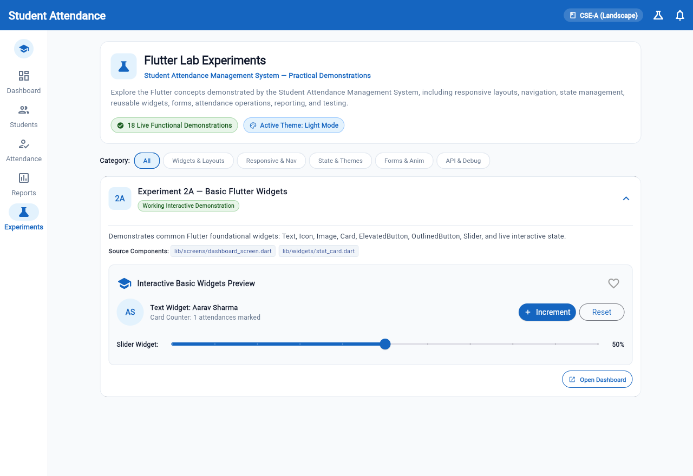

**Objective:** Explore common Flutter widgets and understand how widget properties and state affect the user interface.

**Concepts demonstrated:**
- Basic widget composition and text styling.
- Interactive counter controls.
- Favorite toggle and avatar.
- Slider-driven value changes.
- Updating the interface in response to user interaction.

**Learning outcome:** Understand how Flutter widgets are composed and how interactive controls can update visible UI state.

## Experiment 2B — Row, Column and Stack

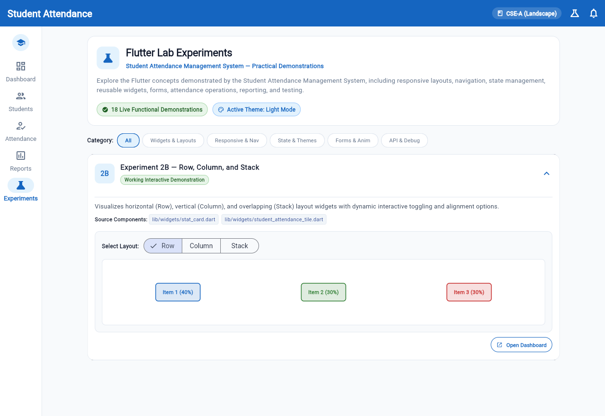


**Objective:** Compare the main Flutter layout widgets used to arrange content horizontally, vertically, and in layers.

**Concepts demonstrated:**
- `Row` for horizontal layout.
- `Column` for vertical layout.
- `Stack` and positioned elements for overlays.
- Switching between layout demonstrations.

**Learning outcome:** Choose an appropriate layout widget for arranging interface elements and layering content.

## Experiment 3A — Responsive UI Design

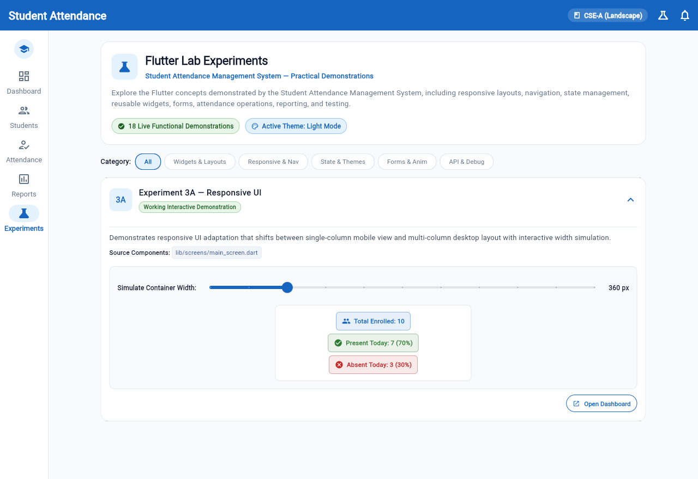

**Objective:** Demonstrate how a layout can adapt to different available widths.

**Concepts demonstrated:**
- Responsive container sizing.
- Width controls for testing different viewport sizes.
- Reflow between single-column and multi-column layouts.
- Flexible layout composition.

**Learning outcome:** Build interfaces that adapt to different screen sizes rather than relying on one fixed layout.

## Experiment 3B — MediaQuery and Breakpoints

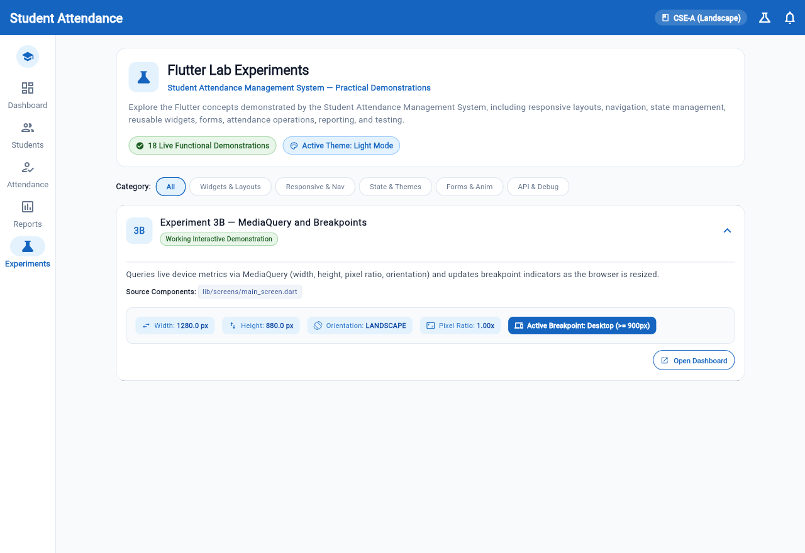

**Objective:** Inspect the current device or browser dimensions and use them to understand responsive breakpoints.

**Concepts demonstrated:**
- `MediaQuery`.
- Screen width and height.
- Orientation and device pixel ratio.
- Compact, medium, and expanded layout categories.

**Learning outcome:** Use available viewport information to make informed responsive-layout decisions.

## Experiment 4A — Navigator Navigation

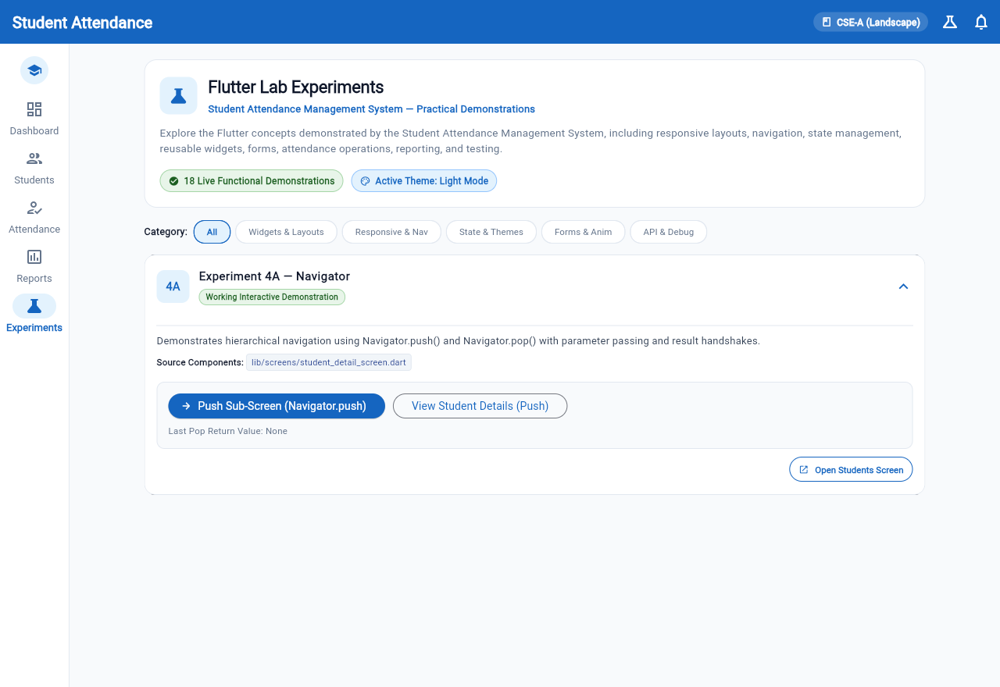

**Objective:** Demonstrate navigation between screens using Flutter's Navigator API.

**Concepts demonstrated:**
- `Navigator.push()`.
- `Navigator.pop()`.
- Opening and closing a detail screen.
- Passing and returning a navigation result.

**Learning outcome:** Understand how Flutter manages a navigation stack and how a screen can return a result to the previous screen.

## Experiment 4B — Named Routes Architecture


**Objective:** Demonstrate route-based navigation and centralize screen navigation logic.

**Concepts demonstrated:**
- Named route definitions.
- `Navigator.pushNamed()`.
- Route arguments.
- Route generation and return-result handling.

**Learning outcome:** Understand how named routes can organize navigation in a multi-screen Flutter application.

## Experiment 5A — StatefulWidget and StatelessWidget

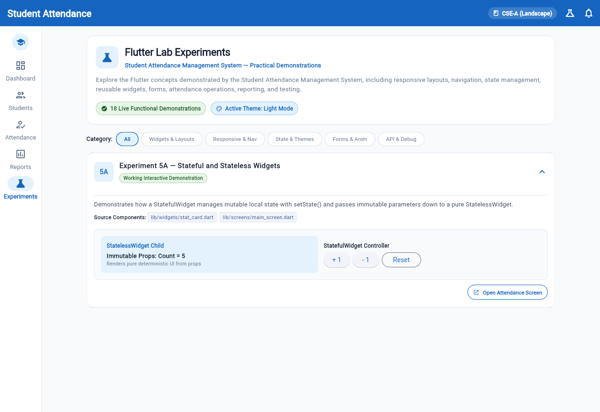

**Objective:** Compare widgets that manage mutable state with widgets that display data supplied through their configuration.

**Concepts demonstrated:**
- `StatefulWidget` and its associated `State`.
- `StatelessWidget`.
- `setState()`.
- Passing values and callbacks between widgets.

**Learning outcome:** Decide where local state belongs and how reusable child widgets can receive data and callbacks.

## Experiment 5B — Provider State Management

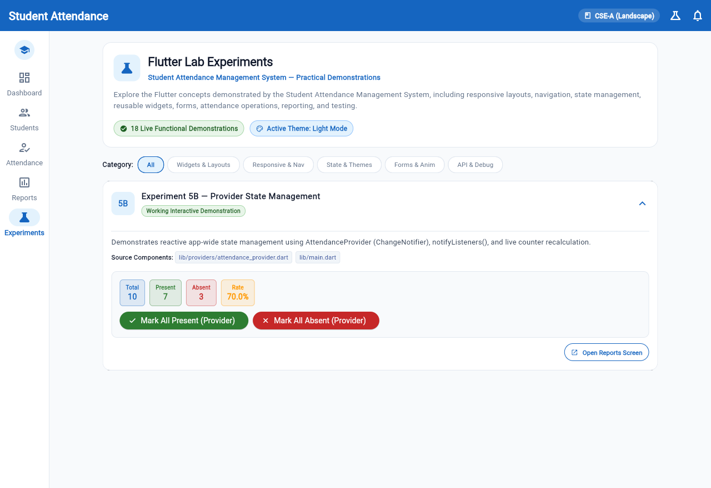

**Objective:** Demonstrate reactive state management with Provider in the attendance application.

**Concepts demonstrated:**
- `ChangeNotifier`.
- `ChangeNotifierProvider`.
- `Consumer`.
- `notifyListeners()`.
- Updating attendance data and reflecting changes in the UI.

**Learning outcome:** Understand how shared application state can notify listening widgets when data changes.

## Experiment 6A — Custom Reusable Widgets

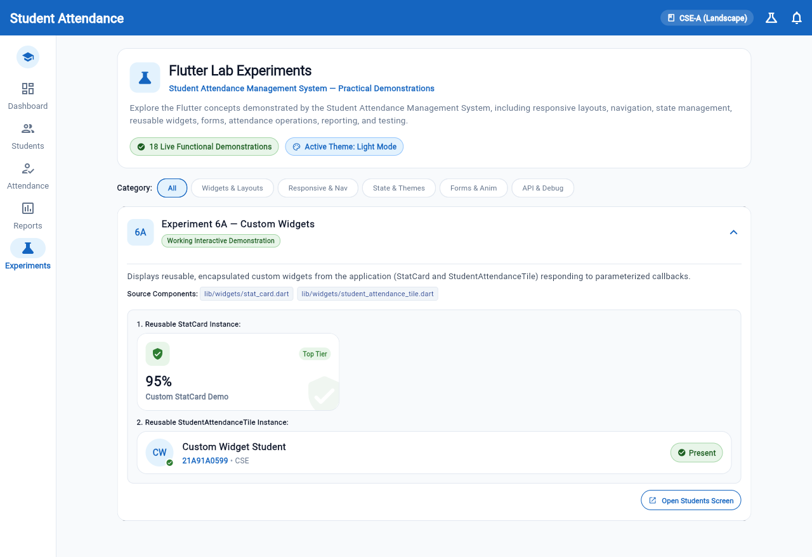

**Objective:** Show how repeated UI patterns can be packaged into reusable custom widgets.

**Concepts demonstrated:**
- Custom widget classes.
- Widget parameters and callbacks.
- Reuse of `StatCard` and `StudentAttendanceTile`, where present in the implementation.
- Consistent presentation of student and attendance information.

**Learning outcome:** Reduce duplicated UI code and make interface components easier to maintain.

## Experiment 6B — Themes and Styles

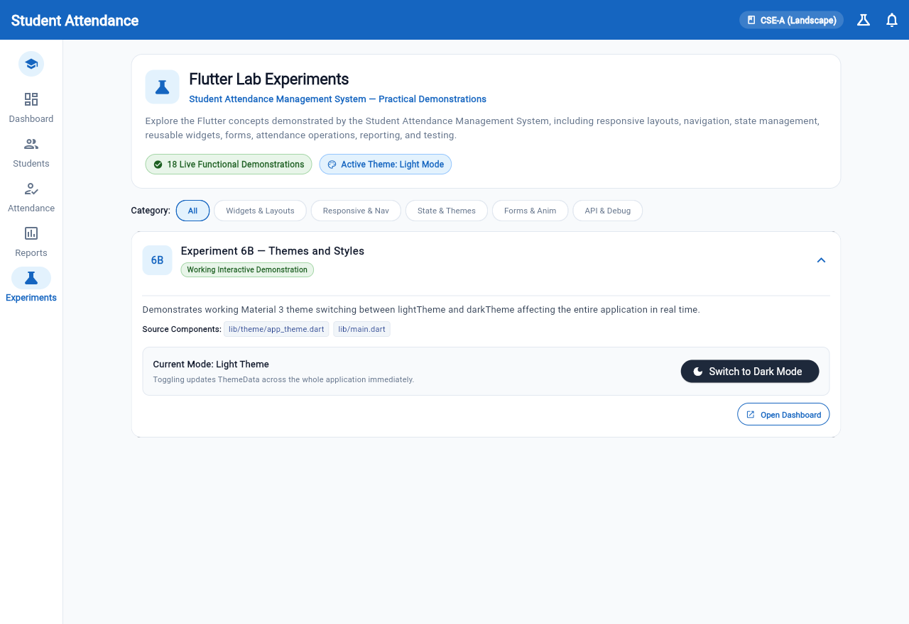

**Objective:** Demonstrate centralized styling and switching between application themes.

**Concepts demonstrated:**
- `ThemeData`.
- Material 3 styling.
- Centralized theme configuration.
- Light and dark themes, where enabled by the application.
- Consistent colors and typography.

**Learning outcome:** Maintain a consistent visual design by defining shared styles rather than styling every widget independently.

## Experiment 7A — Forms and User Input

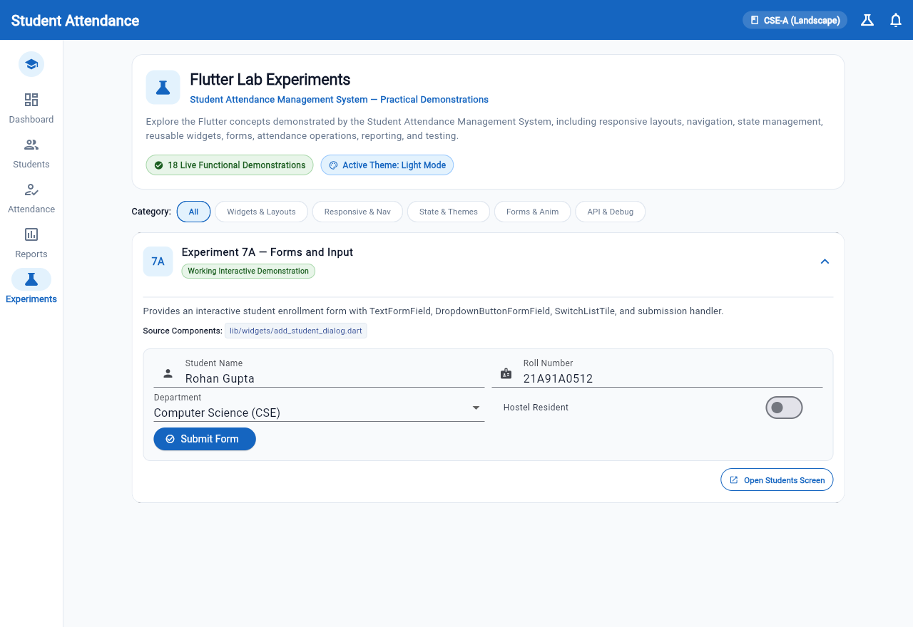

**Objective:** Collect and process student information through Flutter form controls.

**Concepts demonstrated:**
- `Form` and `TextFormField`.
- Text input for student details.
- Department selection with a dropdown.
- Attendance-status selection where implemented.
- Form submission and user feedback.

**Learning outcome:** Build structured forms that collect user input and pass valid values to application logic.

## Experiment 7B — Form Validation and Error Handling

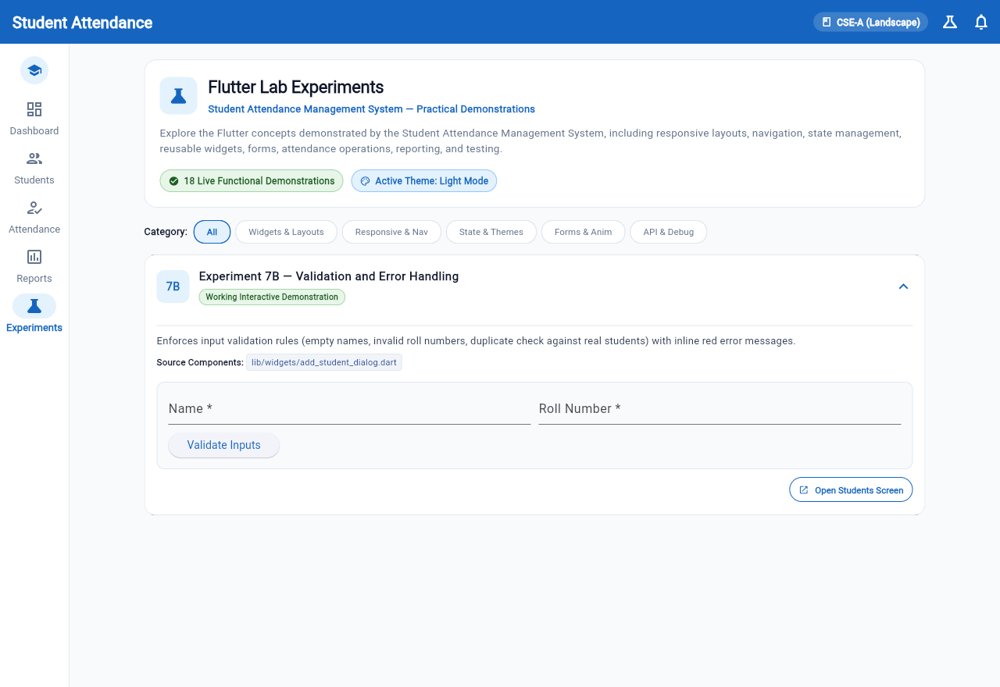

**Objective:** Validate user input and provide useful feedback when submitted values do not meet requirements.

**Concepts demonstrated:**
- Required-field validation.
- Input-length and roll-number validation.
- Duplicate roll-number prevention.
- Inline validation messages.
- Handling invalid submissions.

**Learning outcome:** Prevent common input errors and guide users toward valid form submissions.

## Experiment 8A — Explicit Animations

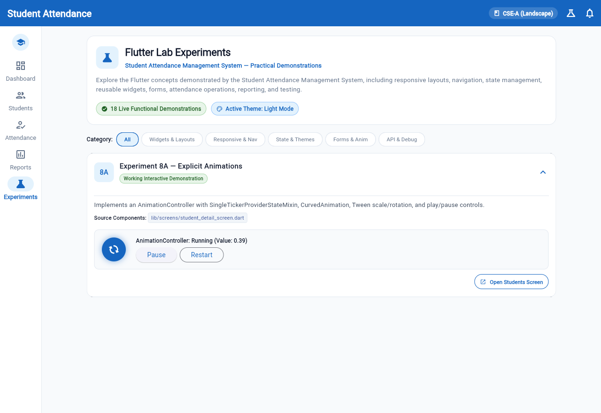

**Objective:** Demonstrate animations controlled through an animation controller.

**Concepts demonstrated:**
- `AnimationController`.
- `SingleTickerProviderStateMixin`.
- `Tween`.
- `CurvedAnimation`.
- Explicit animation controls such as play, pause, or restart, where implemented.

**Learning outcome:** Understand how explicit animations provide control over animation timing and progression.

## Experiment 8B — Implicit Animations

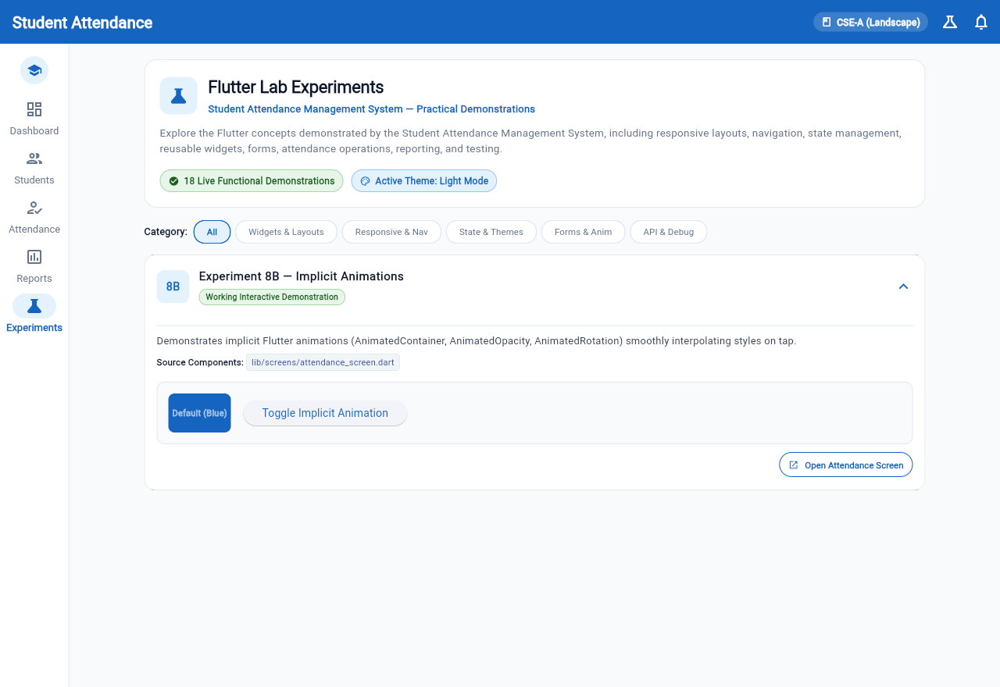

**Objective:** Demonstrate transitions that animate automatically when widget properties change.

**Concepts demonstrated:**
- `AnimatedContainer`.
- `AnimatedOpacity`.
- Animated changes to visual properties.
- State changes triggered by user interaction.

**Learning outcome:** Use implicit animations to add smooth visual transitions without managing an animation controller directly.

## Experiment 9A — REST API Fetching

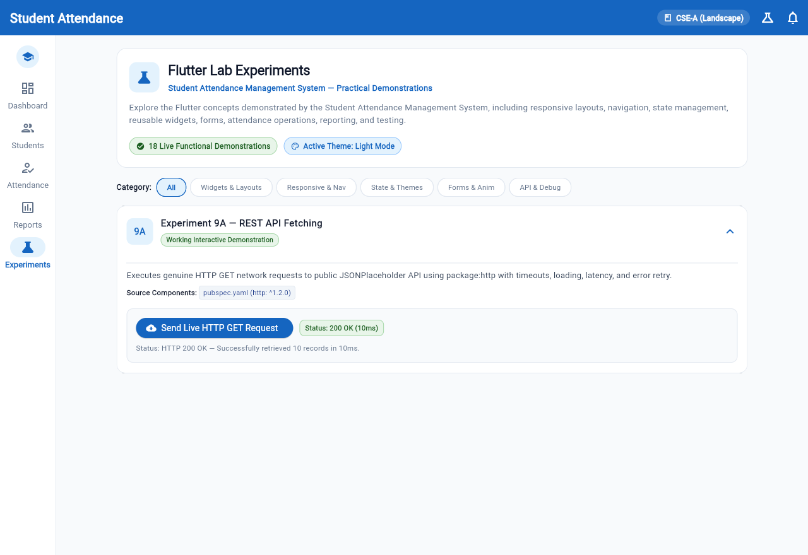

**Objective:** Demonstrate how a Flutter application can retrieve data from a REST API.

**Concepts demonstrated:**
- HTTP GET requests.
- Asynchronous request handling.
- HTTP response status.
- Loading and error states.
- Retry behavior, where implemented.

**Learning outcome:** Understand the basic flow of requesting remote data and handling the response in a Flutter interface.

## Experiment 9B — Displaying API Data

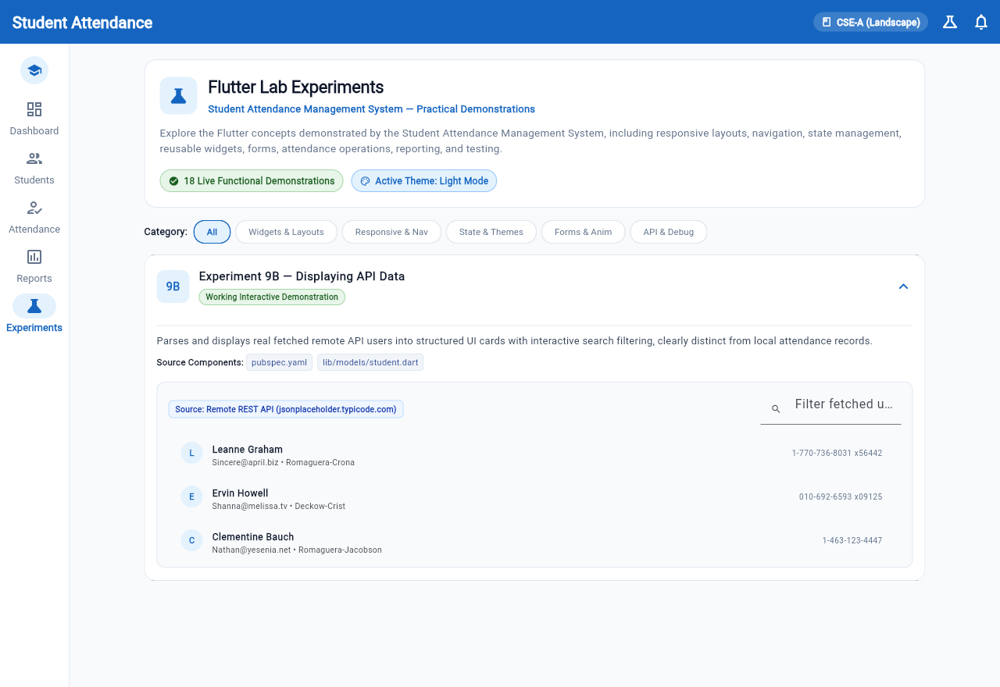

**Objective:** Convert API response data into a structure that can be displayed and searched in the UI.

**Concepts demonstrated:**
- JSON parsing.
- Mapping response data into structured objects.
- Rendering API data as cards or list items.
- Searching and filtering displayed results.

**Learning outcome:** Understand how remote JSON data can be parsed, represented, displayed, and filtered.

## Experiment 10A — Unit and Widget Testing

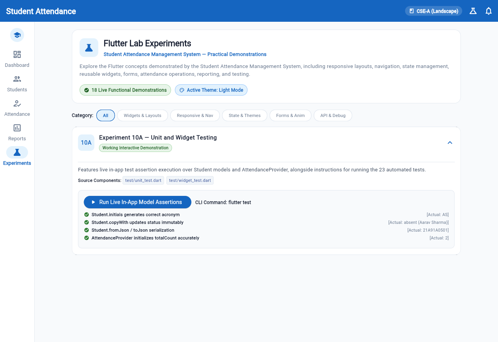

**Objective:** Demonstrate automated testing of application logic and Flutter widgets.

**Concepts demonstrated:**
- Unit tests.
- Widget tests.
- Assertions and expected results.
- Test execution with `flutter test`.
- In-app test demonstrations, if present in the current implementation.

**Learning outcome:** Learn how tests can detect regressions and verify expected behavior. Automated test counts and results should be based on the current test run.

## Experiment 10B — Debugging Tools

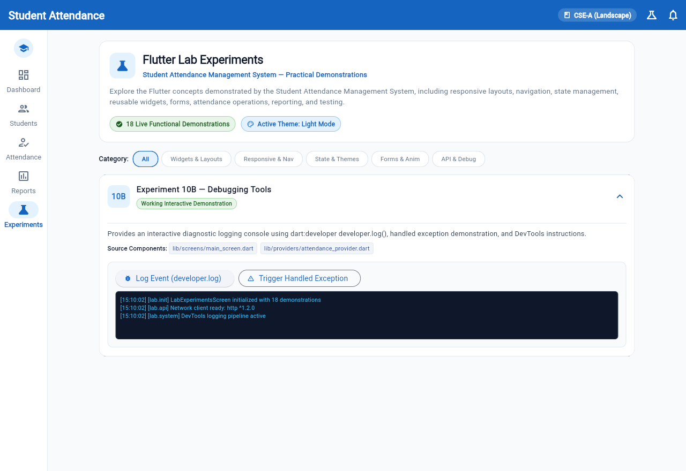

**Objective:** Introduce diagnostic logging and error inspection techniques for Flutter development.

**Concepts demonstrated:**
- Diagnostic messages.
- `dart:developer` and `developer.log()`, where used.
- Exception handling.
- Inspecting logs and troubleshooting runtime behavior.
- Flutter DevTools guidance, where provided.

**Learning outcome:** Use logs and diagnostic tools to investigate unexpected application behavior.

## Technology Stack
- **Framework**: Flutter 3.x (Dart 3.x)
- **UI Design System**: Material 3 Design with custom `AppTheme` and responsive layouts
- **State Management**: `provider` (v6.1.5) with `ChangeNotifier` and `Consumer`
- **Architecture**: Modular screen architecture with separated models, providers, themes, and reusable widgets
- **Testing**: `flutter_test` with unit tests and widget tests

## Getting Started
1. Install Flutter (stable channel) and Git.
2. Clone this repository:
   ```bash
   git clone https://github.com/sreekarb934-alt/student-attendance-management-system.git
   cd student_attendance
   ```
3. Install dependencies:
   ```bash
   flutter pub get
   ```
4. Run the application:
   ```bash
   flutter run -d chrome
   ```

## Testing & Quality Assurance
The codebase adheres strictly to Dart coding standards and passes static analysis, automated testing, and web compilation:

```bash
# 1. Static Analysis (0 errors, 0 warnings)
flutter analyze

# 2. Automated Test Suite (23 automated tests: 12 unit tests + 11 widget tests)
flutter test

# 3. Production Web Compilation
flutter build web
```

*(Note: In Windows environments with strict Application Control or AppLocker policies, ensure the developer shell has execution permissions for Dart runtime child processes).*

## Current Limitations & Notes
In accordance with the Flutter lab project requirements, student data is managed dynamically via `AttendanceProvider`. The application does not require external proprietary cloud services to run, test, or evaluate.

## Future Improvements
- Local SQLite or Hive offline persistence
- Export attendance logs to CSV and PDF formats
- Multi-session timetable and class schedules
- Biometric and QR-code attendance check-in

## License
Academic project developed for CS506PC – UI Design (Flutter Lab).

---


