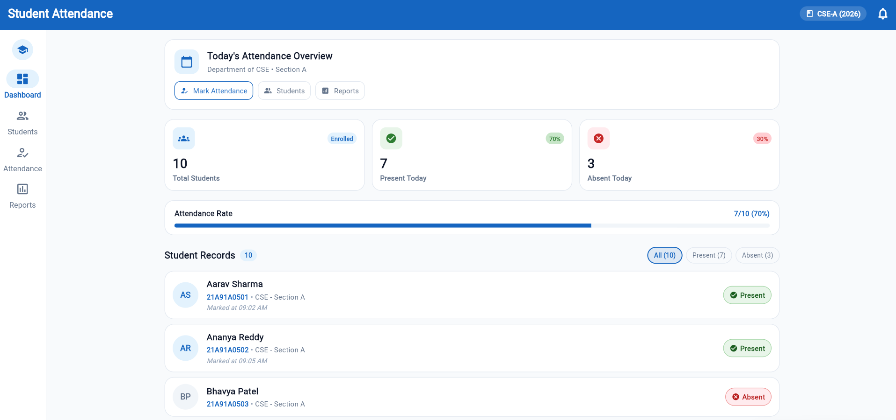
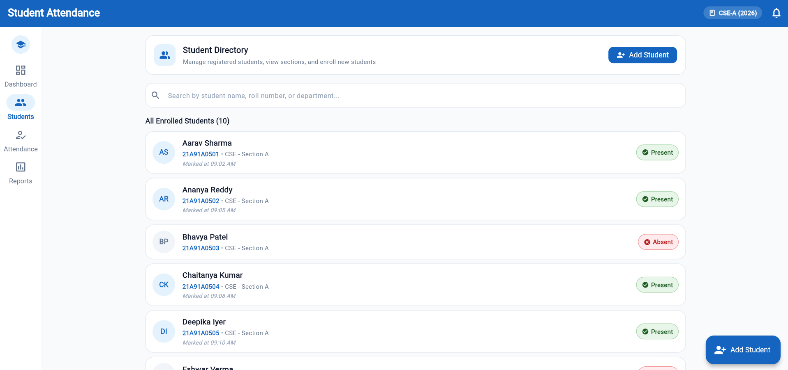
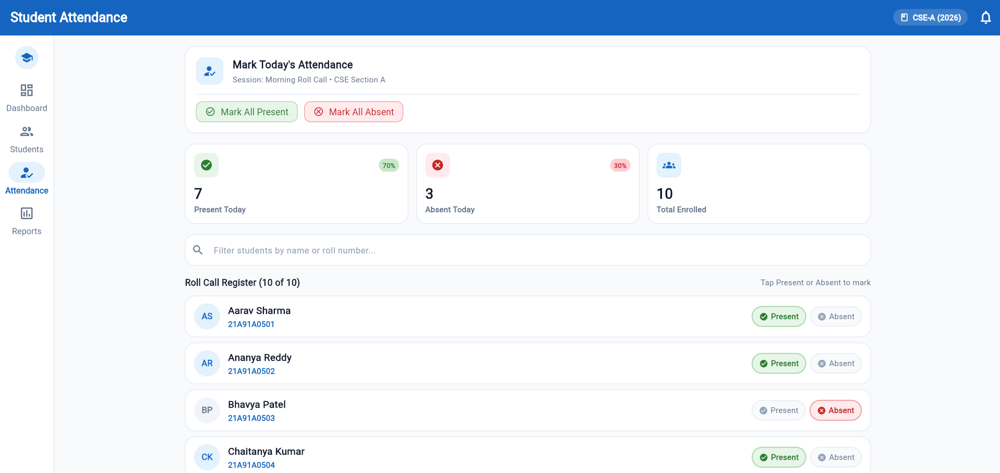
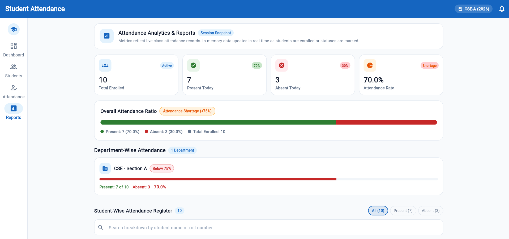

# Student Attendance Management System

A modern student attendance management application built with Flutter and Dart.

## Features
- Dashboard with attendance statistics
- Student management and validation
- Attendance marking for present and absent students
- Reports, attendance percentages, and department summaries

## Technology Stack
- Flutter and Dart
- Material Design
- Git and GitHub

## Getting Started
1. Install Flutter and Git.
2. Clone this repository: https://github.com/sreekarb934-alt/student-attendance-management-system
3. Run: flutter pub get
4. Launch: flutter run -d chrome

## Testing
Run flutter analyze and flutter test.
The project passed static analysis and all 11 automated tests during development.

## Current Limitations
Student and attendance data are stored in memory and do not persist across application restarts.

## Future Improvements
- Persistent database storage
- Date-wise attendance history
- Authentication and role-based access
- CSV and PDF report exports
- Web deployment

## License
No open-source license has been specified yet.

## Application Preview

### Dashboard

### Student Management

### Attendance

### Reports and Analytics

